# 复杂文档 RAG 工程实践

基于 MaxKB 的复杂文档 RAG 工程实践，集成 MinerU 解析、两阶段异步构建、结构感知分块与多层缓存，并通过冻结题集、消融实验和逐题回归验证效果。

## 本 fork 的改动

演示 GIF 待补，预留文件位置为 `docs/images/demo.gif`。演示流程为上传扫描 PDF、保存占位预览、等待后台解析及向量化、提问并查看引用来源。

### 架构

```mermaid
flowchart LR
    UI[MaxKB Vue 管理端 / 聊天端] --> WEB[MaxKB Django API]
    WEB --> ROUTE[解析路由 / PDF 文字层探测]
    ROUTE --> NATIVE[MaxKB 原生解析]
    ROUTE --> PARSE[第一级缓存 / 文件哈希解析缓存]
    PARSE --> PREVIEW[阶段一 / 快速提交与占位预览]
    PREVIEW --> BUILD[阶段二 / Celery mineru 异步构建]
    BUILD --> WRAP[Content List 封装 / 8004 单进程]
    WRAP --> FILE[MinerU 文件接口 / 8003]
    FILE --> MINERU[MinerU 上游 / 8000 / 默认 Basic]
    MINERU --> WRAP
    WRAP --> PARSE
    PARSE --> BUILD
    BUILD --> CHUNK[标题前缀 / 表格感知子块]
    NATIVE --> CHUNK
    CHUNK --> VCACHE[第二级缓存 / PG 文档向量]
    VCACHE --> EMBED[MaxKB local_model]
    VCACHE --> VECTOR[(MaxKB PostgreSQL / pgvector)]
    WEB --> L1[第三级缓存 / L1 精确问答]
    L1 --> QCACHE[第二级缓存 / Redis 查询向量]
    QCACHE --> EMBED
    QCACHE --> VECTOR
    VECTOR --> PROMPT[检索证据 / 提示词注入文档名]
    PROMPT --> LLM[MaxKB 回答模型 / 带引用响应]
    LLM --> L1
    subgraph EVAL[离线评测体系]
        RETRIEVAL[开发集 / 冻结留出集 / 消融 / 逐题回归]
        ANSWER[回答对照 / AI 评分与稳定性复核]
        L2[L2 语义缓存阈值与误命中分析]
    end
    VECTOR -.-> RETRIEVAL
    LLM -.-> ANSWER
    EMBED -.-> L2
    classDef upstream fill:#f1f5f9,stroke:#64748b,color:#0f172a;
    classDef fork fill:#dbeafe,stroke:#2563eb,stroke-width:2px,color:#172554;
    classDef offline fill:#fef3c7,stroke:#a16207,stroke-dasharray:5 5,color:#422006;
    class UI,WEB,NATIVE,EMBED,VECTOR,LLM upstream;
    class ROUTE,PARSE,PREVIEW,BUILD,WRAP,CHUNK,VCACHE,L1,QCACHE,PROMPT fork;
    class FILE,MINERU upstream;
    class RETRIEVAL,ANSWER,L2 offline;
```



灰色为 MaxKB 与 MinerU 上游组件，蓝色为本 fork 的集成和改动，黄色虚线为离线评测。三级缓存分别覆盖解析、向量和精确问答，向量层包含文档与查询两种缓存。L2 当前处于离线探索阶段。

### 我做了什么

#### MinerU 解析集成与两阶段异步构建

扫描件和图片 PDF 缺少可检索文字，复杂解析还会占用上传请求。
增加文字层探测、可配置路由与独立 Content List 封装，先返回占位预览，再由独立 mineru 队列构建真实段落并投递向量化。
通过文件哈希解析缓存、持久化任务身份、事务提交后投递与尝试版本校验处理复用、重试及迟到结果。
扫描件和图片类召回均有改善，原生链路逐题回归与基线一致，数值见效果总表。 [解析对比](eval/results/compare.md) [原生回归](eval/results/native-compare.md)

#### 子块标题前缀与表格感知切分

普通子块缺少标题上下文，按字符切分还会破坏表格标签和行列关系。
在实际 embedding 输入中附加父段落标题，将表格按行分组并重复表头，复用父段落与子块结构。
消融中标题前缀贡献主要收益，表格切分保留结构并改善部分排名，组合配置也在同语料新问题上得到验证。
当前标题来自 `Paragraph.title`，其中部分由文档名兜底。 [消融报告](eval/results/week3/README.md) [留出集报告](eval/results/week3/holdout/README.md)

| 配置 | 解析来源 | 标题前缀 | 表格切分 | Recall@5 | MRR |
| --- | --- | --- | --- | --- | --- |
| A | auto | 关 | 关 | 81.67% [A](eval/results/week3/A.json) | 0.6608 [A](eval/results/week3/A.json) |
| B | auto | 开 | 关 | 89.17% [B](eval/results/week3/B.json) | 0.6944 [B](eval/results/week3/B.json) |
| C | auto | 关 | 开 | 83.33% [C](eval/results/week3/C.json) | 0.6789 [C](eval/results/week3/C.json) |
| D | auto | 开 | 开 | 89.17% [D](eval/results/week3/D.json) | 0.7028 [D](eval/results/week3/D.json) |
| E | native | 开 | 开 | 58.33% [E](eval/results/week3/E.json) | 0.4486 [E](eval/results/week3/E.json) |

每组运行同一开发集 60 题、各一轮。B 与 D 的 Recall@5 相同，D 的排名质量略有改善。A–D 使用相同冻结段落，E 使用冻结原生段落。 [实验控制与归因](eval/results/week3/README.md)

#### 向量缓存与 L1 问答缓存

重复建库、重复查询与相同问题会重复调用模型。
以模型实例指纹和实际输入哈希复用 PG 文档向量与 Redis 查询向量，并实现带授权范围、知识库版本及提示词指纹的 L1 精确问答缓存。
结合 single-flight、引用复核和缓存异常回源处理并发与失效，命中仍经现有聊天记录保存流程。
本地向量实验逐题保持一致，真实回答 API 的重复负载减少了模型调用和 token 用量。 [向量与协议验收](eval/results/week4/README.md) [真实 LLM 对照](eval/results/week5/README.md)

#### L2 离线评估与上线决策

相似问法可能改变答案属性，单一向量相似度难以保证答案可复用。
按意图组划分开发与测试查询，在开发集选阈值后锁定测试，保留困难负例及逐题分数。
误命中案例把“列出 CSF 函数”复用到“各函数的子类别数量”，提高阈值又排除了可正确复用的问题。
据此将 L2 保留为离线实验，上线前仍需人工审核标签和对象、数字、限定词及证据一致性验证。 [误命中与阈值取舍](eval/results/week4/README.md)

#### 提示词注入文档名

引用元数据已有文档名，但模型输入缺少该信息时，回答会对单位归属犹豫或套用其他单位规定。
将文档名加入资料提示词，并把资料格式开关纳入 L1 指纹，使用同题、同配置和相同检索段落进行回答对照。
**AI 评分，未经人工复核。** 采用修复知识库绑定后的批次，配对结果见总表，出处边界项保留待复核。
部分归属改善在第二遍复现，跨单位陷阱仍出现自相矛盾，目标条款缺失也会限制回答。 [修复批次分析](eval/results/week5/answer/repaired/analysis.md)

#### 修复的框架 bug

修复 `tokenize_by_paragraph` 重建关键词时与子块向量错位的问题。向量元数据保存实际 `embedding_text`，首次索引和重新分词共用该文本，关联问题向量按类型隔离。历史记录使用确定顺序对齐，数量不一致时明确失败，避免部分错配。 [实现与历史数据回归](eval/results/week3/README.md)

### 效果总表

所有效果数字均链接到 `eval/results/` 中的报告或原始结果。Recall 按问题宏平均，跨段落题可以只命中部分证据。

| 项目与样本 | 对照结果 | 实验条件与限定 |
| --- | --- | --- |
| MinerU 接入，开发集 60 题 [来源](eval/results/after.json) | Recall@5 为 56.67% [基线](eval/results/baseline.json) → 81.67% [Auto](eval/results/after.json) | 固定语料单轮，扫描样本为清晰受控栅格化页面，来源有限 |
| 扫描件类、图片类各 10 题 [来源](eval/results/compare.md) | 两类分别由 0/10 → 9/10 [来源](eval/results/compare.md) | 图片题来自无文字层 PDF，覆盖其中可见文字 |
| 结构化子块，开发集 60 题 [来源](eval/results/week3/README.md) | Recall@5 为 81.67% → 89.17%，MRR 为 0.6608 → 0.7028 [来源](eval/results/week3/README.md) | A 与 D 对照，冻结段落、模型、阈值和评分器，每组单轮 |
| 冻结留出集 20 题 [来源](eval/results/week3/holdout/README.md) | Recall@5 为 45.00% → 67.50%，MRR 为 0.3917 → 0.4992 [来源](eval/results/week3/holdout/README.md) | 同语料新问题，作者接触过旧分析，题型近似配比，各一轮 |
| 冷、热向量重建，103 个父段落 / 273 个子块向量 [来源](eval/results/week4/README.md) | 模型调用 102 → 0，向量化 50.1261 s → 0.4507 s，总重建 57.5289 s → 9.8331 s [来源](eval/results/week4/README.md) | 本地 CPU 模型，单次实测，冷缓存时模型权重已加载，Celery eager 执行正常重建任务 |
| 查询缓存，60 题逐题回归 [来源](eval/results/week4/README.md) | 平均检索 158.68 ms → 32.68 ms，逐题质量差异 0 [来源](eval/results/week4/README.md) | 关闭组与开启第二遍对照，进程内 Django 测试客户端，重复请求在 TTL 内执行 |
| L1 真实模型，12 题 [来源](eval/results/week5/README.md) | 响应 P50 为 1242.58 ms → 27.02 ms，业务模型调用 12 → 0，供应商总 token 为 24751 → 0 [来源](eval/results/week5/README.md) | DeepSeek Flash，流式，单次本地实测，关闭组与第二遍完全重复负载对照，质量另行评估 |
| L2 测试集 16 题 [来源](eval/results/week4/README.md) | 阈值 0.915 时接受 7/16，误接受 1/7，即 14.29% [来源](eval/results/week4/README.md) | 标签为助手草案、待人工审核，阈值由独立开发查询选择，离线探索 |
| 文档名注入，20 题 / 两组各两遍 [来源](eval/results/week5/answer/repaired/README.md) | 首遍双方已决配对 18 题，均分 0.5833 → 0.8611，提高 5 题，另有 2 题待复核 [来源](eval/results/week5/answer/repaired/analysis.md) | **AI 评分，未经人工复核**，实现与出题由同一 AI 完成，第二遍尚无独立盲评分数 |

### 快速开始

在 Linux 或启用 Docker 的 WSL 中使用 Docker Compose，先克隆本 fork。

```bash
git clone https://github.com/20212661/maxkb-rag-enhanced.git
cd maxkb-rag-enhanced
```

在仓库根目录执行以下三步。

1. 创建配置文件。

   ```bash
   cp .env.example .env
   ```

2. 将 `.env` 中的 `change-me` 替换为独立密码，或运行下面的命令自动生成随机值。首次启动前确认 `ADMIN_PASSWORD`、`DB_PASSWORD`、`REDIS_PASSWORD` 和 `SECRET_KEY` 已完成替换，并填写 `LLM_API_BASE`、`LLM_MODEL_NAME` 和 `LLM_API_KEY`。

   ```bash
   python3 deploy/configure.py
   ```

3. 构建并启动服务。

   ```bash
   docker compose up -d --build --wait --wait-timeout 1800
   ```

启动后执行一条命令，创建示例知识库和应用，并验证带引用的回答。

```bash
docker compose run --rm demo-import
```

管理端地址由 `.env` 的 `WEB_PUBLIC_URL` 配置，登录账号与密码为 `ADMIN_USERNAME`、`ADMIN_PASSWORD`。首次启动会下载基础镜像、依赖和 MinerU Basic 模型。前端构建设置 `NODE_OPTIONS=--max-old-space-size=4096`，管理端与聊天端顺序构建，由 web 提供静态资源。

GPU 的可选 profile、配置说明及日常操作见 [部署说明](deploy/README.md)，当前标记为“未在 GPU 硬件上验证”。公开样例与来源见 [demo-data](demo-data/README.md)，评测语料来源见 [语料清单](eval/assets/README.md)，从零启动的实测状态见 [部署验收](docs/deploy-verification.md)。

### 评测方法

- 开发集为 60 题，包括事实、跨段落、表格、扫描件和图片类型。题集、语料清单和评分器保存哈希，检索固定 Top-5 与相似度阈值，使用关键句归一化包含匹配计算 Recall 和 MRR。 [开发集结果与配置](eval/results/week3/README.md)
- 冻结留出集为 20 道同语料新问题，首次正式请求前记录哈希与冻结时间，A、D 各运行一轮。作者接触旧分析的情况和重复检查范围均已披露。 [冻结与留出验证](eval/results/week3/holdout/README.md)
- A–E 消融独立建库，分别控制标题前缀、表格切分及解析来源，复用冻结段落，重新生成子块和向量。 [消融矩阵](eval/results/week3/README.md)
- 缓存阶段在关闭缓存时逐题比较 Recall@1、Recall@5、倒数排名、完整证据覆盖与各名次证据命中，保留原始结果。 [缓存逐题回归](eval/results/week4/README.md)
- 回答实验使用定向题集、两组两遍、冻结评分规则和首遍盲评，采用绑定修复后的数据。AI 评分与第二遍文本稳定性分别记录。 [回答实验](eval/results/week5/answer/repaired/README.md)

复跑入口位于 [eval/README.md](eval/README.md)，本机知识库与文档映射配置由使用者重新生成。

```bash
# 在已配置 MaxKB 的 Python 环境运行
python eval/verify_cache.py --phase vector --benchmark --config eval/.local-week3-D.json
python eval/l2_threshold.py --vectors eval/results/week4/l2/vectors.json --plot
```

### 已知限制

- Basic 仍可能将流程图、漫画对白保留为图片，图形关系和空间推理尚未评测。PPT 目前提取 Flash 文字，内嵌扫描图识别有限。ZIP 成员和工作流文档提取节点沿原生链路。PDF 探测采用逐页软预算，单页卡死无法中断。 [解析限制](docs/week2-report.md)
- OCR 字符与标点遗漏会影响严格关键句评分，新增解析内容也会改变检索竞争。扫描样本清晰、来源有限，留出集复用相同语料，独立作者和新文档泛化仍需验证。 [失败分析](docs/week2-failure-analysis.md) [留出集边界](eval/results/week3/holdout/README.md)
- 表格嵌套或处理异常会回到普通分块，完整表头可能超过目标长度，标题部分由文档名兜底。 [分块行为](eval/results/week3/README.md)
- 向量缓存遇到远端同名模型升级或服务地址切换时，需要增加 epoch 并刷新相关进程。跨进程配置广播、PG 缓存容量自动淘汰尚待完善。 [向量缓存边界](docs/vector-cache.md)
- L1 适用于满足准入条件的无历史简单 RAG。绕过向量存储封装的修改可能绕过版本事件，重建期间可见中间索引，完整快照与部分配置失效事件尚待完善。 [L1 边界](docs/answer-cache.md)
- L2 标签待人工审核。回答评分由同一实现与出题 AI 完成，出处边界项待复核，第二遍陷阱题仍可能自相矛盾。文档名覆盖无法替代条款级证据核查。 [L2](eval/results/week4/README.md) [回答限制](eval/results/week5/answer/repaired/analysis.md)
- 仓库已有全量前端 lint 和部分后端 Ruff 问题，历史报告记录了范围检查结果。部署构建的 Node 堆和解析进程均需要足够内存，实际资源与验收状态见部署记录。 [历史检查](docs/week2-report.md) [部署验收](docs/deploy-verification.md)

### 致谢与协议

感谢 [MaxKB](https://github.com/1Panel-dev/MaxKB) 提供应用、知识库、模型与工作流基础，感谢 [MinerU](https://github.com/opendatalab/MinerU) 提供复杂文档解析能力。本项目在父子分块和分层缓存的设计上参考了 [Dify](https://github.com/langgenius/dify)。

MaxKB 使用 GPL-3.0，本 fork 保持 GPL-3.0，完整条款见 [LICENSE](LICENSE)。MinerU、Dify 及其他依赖遵循各自仓库的许可证。

---

## 上游 MaxKB

以下保留上游项目介绍与 GPL-3.0 授权说明。

<p align="center"></p>
<h3 align="center">Open-source platform for building enterprise-grade agents</h3>
<h3 align="center">强大易用的企业级智能体平台</h3>
<p align="center"><a href="https://trendshift.io/repositories/9113" target="_blank"></a></p>
<p align="center">
  <a href="https://www.gnu.org/licenses/gpl-3.0.html#license-text"></a>
  <a href="https://github.com/1Panel-dev/maxkb/releases/latest"></a>
  <a href="https://github.com/1Panel-dev/maxkb"></a>    
  <a href="https://hub.docker.com/r/1panel/maxkb"></a><br/>
 [<a href="/README_CN.md">中文(简体)</a>] | [<a href="/README.md">English</a>] 
</p>
<hr/>

MaxKB = Max Knowledge Brain, it is an open-source platform for building enterprise-grade agents. MaxKB integrates Retrieval-Augmented Generation (RAG) pipelines, supports robust workflows, and provides advanced MCP tool-use capabilities. MaxKB is widely applied in scenarios such as intelligent customer service, corporate internal knowledge bases, academic research, and education.

- **RAG Pipeline**: Supports direct uploading of documents / automatic crawling of online documents, with features for automatic text splitting, vectorization. This effectively reduces hallucinations in large models, providing a superior smart Q&A interaction experience.
- **Agentic Workflow**: Equipped with a powerful workflow engine, function library and MCP tool-use, enabling the orchestration of AI processes to meet the needs of complex business scenarios.
- **Seamless Integration**: Facilitates zero-coding rapid integration into third-party business systems, quickly equipping existing systems with intelligent Q&A capabilities to enhance user satisfaction.
- **Model-Agnostic**: Supports various large models, including private models (such as DeepSeek, Llama, Qwen, etc.) and public models (like OpenAI, Claude, Gemini, MiniMax, etc.).
- **Multi Modal**: Native support for input and output text, image, audio and video.

## Quick start

Execute the script below to start a MaxKB container using Docker:

```bash
docker run -d --name=maxkb --restart=always -p 8080:8080 -v ~/.maxkb:/opt/maxkb 1panel/maxkb
```

Access MaxKB web interface at `http://your_server_ip:8080` with default admin credentials:

- username: admin
- password: MaxKB@123..

中国用户如遇到 Docker 镜像 Pull 失败问题，请参照该 [离线安装文档](https://maxkb.cn/docs/v2/installation/offline_installtion/) 进行安装。

## Screenshots

<table style="border-collapse: collapse; border: 1px solid black;">
  <tr>
    <td style="padding: 5px;background-color:#fff;"></td>
    <td style="padding: 5px;background-color:#fff;"></td>
  </tr>
  <tr>
    <td style="padding: 5px;background-color:#fff;"></td>
    <td style="padding: 5px;background-color:#fff;"></td>
  </tr>
</table>

## Technical stack

- Frontend：[Vue.js](https://vuejs.org/)
- Backend：[Python / Django](https://www.djangoproject.com/)
- LLM Framework：[LangChain](https://www.langchain.com/)
- Database：[PostgreSQL + pgvector](https://www.postgresql.org/)

## License

Licensed under The GNU General Public License version 3 (GPLv3)  (the "License"); you may not use this file except in compliance with the License. You may obtain a copy of the License at

<https://www.gnu.org/licenses/gpl-3.0.html>

Unless required by applicable law or agreed to in writing, software distributed under the License is distributed on an "AS IS" BASIS, WITHOUT WARRANTIES OR CONDITIONS OF ANY KIND, either express or implied. See the License for the specific language governing permissions and limitations under the License.
