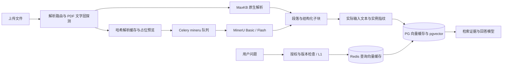

# 复杂文档 RAG 工程实践

基于 MaxKB 的二次开发项目，围绕扫描 PDF、图片和表格完成解析接入、异步构建、结构化子块和缓存，并用冻结评测集验证效果。

## 实现与结果

| 工作 | 工程实现 | 实测结果 |
| --- | --- | --- |
| 复杂文档解析 | MinerU 独立服务、可配置路由、占位预览、Celery 异步构建、哈希解析缓存 | 扫描件类 Recall@5 从 0/10 提升至 9/10，上传占位响应约 0.44 s |
| 子块结构化 | 标题前缀、HTML/Markdown 表格按行分组并重复表头、关键词索引对齐修复 | 开发集 Recall@5 从 81.67% 提升至 89.17%，20 题留出集从 45.0% 提升至 67.5% |
| 向量缓存 | 模型实例指纹与实际输入哈希、PG 文档向量缓存、Redis 查询向量缓存 | 热重建业务模型调用 102 → 0，总耗时 57.53 s → 9.83 s |
| 问答缓存 | L1 精确匹配、向量层版本失效、single-flight、引用与权限校验 | 完成流式与非流式链路验收，真实 LLM 对照待补 |

向量缓存使用本地 CPU 模型。向量化阶段耗时为 50.13 s → 0.45 s，重复查询第二遍的模型调用为 0，平均检索耗时为 158.68 ms → 32.68 ms。缓存性能数据为单次本地实测，60 题检索结果逐题一致。

评测口径、样本数量及限制见 [解析报告](docs/week2-report.md)、[结构化子块消融](eval/results/week3/README.md)、[冻结留出集](eval/results/week3/holdout/README.md) 和 [缓存报告](eval/results/week4/README.md)。L2 使用待人工审核标签进行离线风险分析，数据状态见 [L2 说明](eval/L2_README.md)。

## 架构



## Docker Compose 启动

在 Linux 或已启用 Docker Desktop 集成的 WSL 中，进入项目根目录执行。

```bash
bash deploy/up.sh
```

脚本生成本地配置，构建当前仓库代码和 MinerU 镜像，初始化数据库及模型，启动服务并执行连通性验收。前端构建使用 `NODE_OPTIONS=--max-old-space-size=4096`，管理端与聊天端顺序构建。

访问 `http://localhost:8088/admin/`，初始账号为 `admin`，密码为 `MaxKB@123..`。登录后在模型管理中保存自己的 DeepSeek 或通义千问 API Key，然后创建知识库和简单应用。部署步骤、资源配置和验证状态见 [部署说明](deploy/README.md)。

## 复现实验

```bash
# 在已配置 MaxKB 的 Python 环境运行
python eval/verify_cache.py --phase vector --benchmark --config eval/.local-week3-D.json
python eval/l2_threshold.py --vectors eval/results/week4/l2/vectors.json --plot
```

原始 JSON、数据集、版本哈希和操作说明位于 [eval/](eval/README.md)。第一条命令使用本机知识库映射，准备语料及评测配置的方法也在该目录。

## 当前边界

- PPT v1 提取 Flash 文字，内嵌扫描图的识别留待后续扩展。
- ZIP 成员沿用原生解析，PDF 单页文字层探测采用软时间预算。
- L1 的失效事件集中在向量存储层，绕过该层的修改及重建中间状态见 [缓存边界](docs/answer-cache.md)。
- L2 标签保持待人工审核状态，真实模型 L1 对照和 rerank 实验按 [第 5 周计划](docs/week5-plan.md) 推进。

---

## 上游 MaxKB

以下保留上游项目介绍与 GPL-3.0 授权说明。

<p align="center"></p>
<h3 align="center">Open-source platform for building enterprise-grade agents</h3>
<h3 align="center">强大易用的企业级智能体平台</h3>
<p align="center"><a href="https://trendshift.io/repositories/9113" target="_blank"></a></p>
<p align="center">
  <a href="https://www.gnu.org/licenses/gpl-3.0.html#license-text"></a>
  <a href="https://github.com/1Panel-dev/maxkb/releases/latest"></a>
  <a href="https://github.com/1Panel-dev/maxkb"></a>    
  <a href="https://hub.docker.com/r/1panel/maxkb"></a><br/>
 [<a href="/README_CN.md">中文(简体)</a>] | [<a href="/README.md">English</a>] 
</p>
<hr/>

MaxKB = Max Knowledge Brain, it is an open-source platform for building enterprise-grade agents. MaxKB integrates Retrieval-Augmented Generation (RAG) pipelines, supports robust workflows, and provides advanced MCP tool-use capabilities. MaxKB is widely applied in scenarios such as intelligent customer service, corporate internal knowledge bases, academic research, and education.

- **RAG Pipeline**: Supports direct uploading of documents / automatic crawling of online documents, with features for automatic text splitting, vectorization. This effectively reduces hallucinations in large models, providing a superior smart Q&A interaction experience.
- **Agentic Workflow**: Equipped with a powerful workflow engine, function library and MCP tool-use, enabling the orchestration of AI processes to meet the needs of complex business scenarios.
- **Seamless Integration**: Facilitates zero-coding rapid integration into third-party business systems, quickly equipping existing systems with intelligent Q&A capabilities to enhance user satisfaction.
- **Model-Agnostic**: Supports various large models, including private models (such as DeepSeek, Llama, Qwen, etc.) and public models (like OpenAI, Claude, Gemini, MiniMax, etc.).
- **Multi Modal**: Native support for input and output text, image, audio and video.

## Quick start

Execute the script below to start a MaxKB container using Docker:

```bash
docker run -d --name=maxkb --restart=always -p 8080:8080 -v ~/.maxkb:/opt/maxkb 1panel/maxkb
```

Access MaxKB web interface at `http://your_server_ip:8080` with default admin credentials:

- username: admin
- password: MaxKB@123..

中国用户如遇到 Docker 镜像 Pull 失败问题，请参照该 [离线安装文档](https://maxkb.cn/docs/v2/installation/offline_installtion/) 进行安装。

## Screenshots

<table style="border-collapse: collapse; border: 1px solid black;">
  <tr>
    <td style="padding: 5px;background-color:#fff;"></td>
    <td style="padding: 5px;background-color:#fff;"></td>
  </tr>
  <tr>
    <td style="padding: 5px;background-color:#fff;"></td>
    <td style="padding: 5px;background-color:#fff;"></td>
  </tr>
</table>

## Technical stack

- Frontend：[Vue.js](https://vuejs.org/)
- Backend：[Python / Django](https://www.djangoproject.com/)
- LLM Framework：[LangChain](https://www.langchain.com/)
- Database：[PostgreSQL + pgvector](https://www.postgresql.org/)

## License

Licensed under The GNU General Public License version 3 (GPLv3)  (the "License"); you may not use this file except in compliance with the License. You may obtain a copy of the License at

<https://www.gnu.org/licenses/gpl-3.0.html>

Unless required by applicable law or agreed to in writing, software distributed under the License is distributed on an "AS IS" BASIS, WITHOUT WARRANTIES OR CONDITIONS OF ANY KIND, either express or implied. See the License for the specific language governing permissions and limitations under the License.
