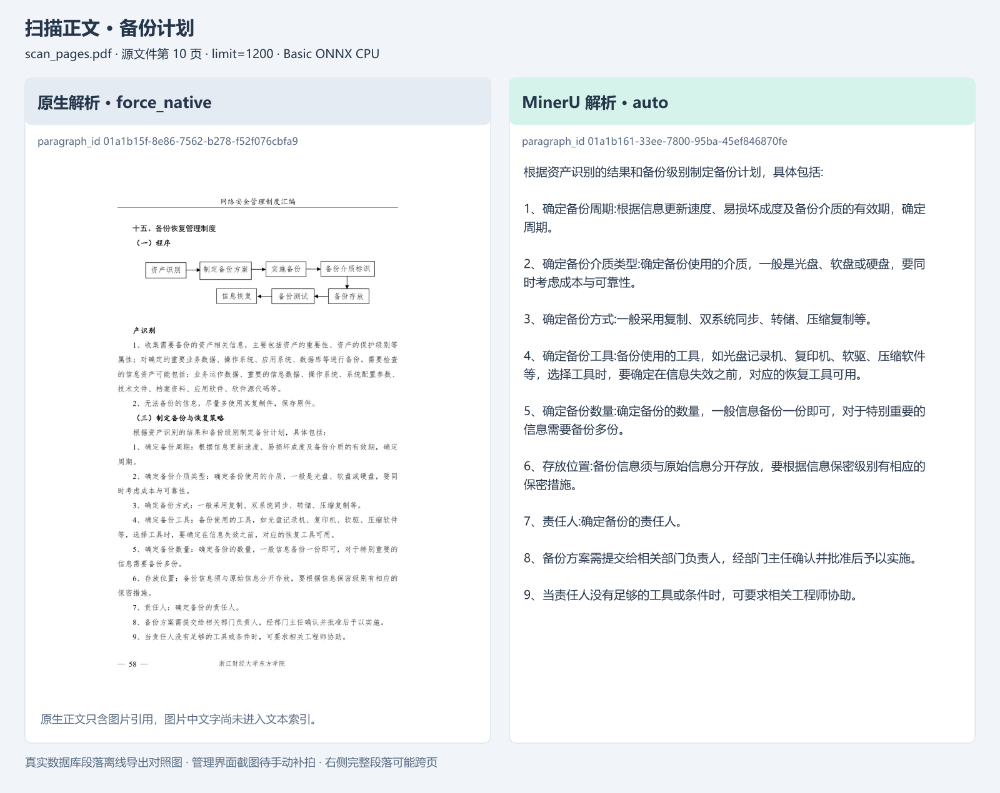
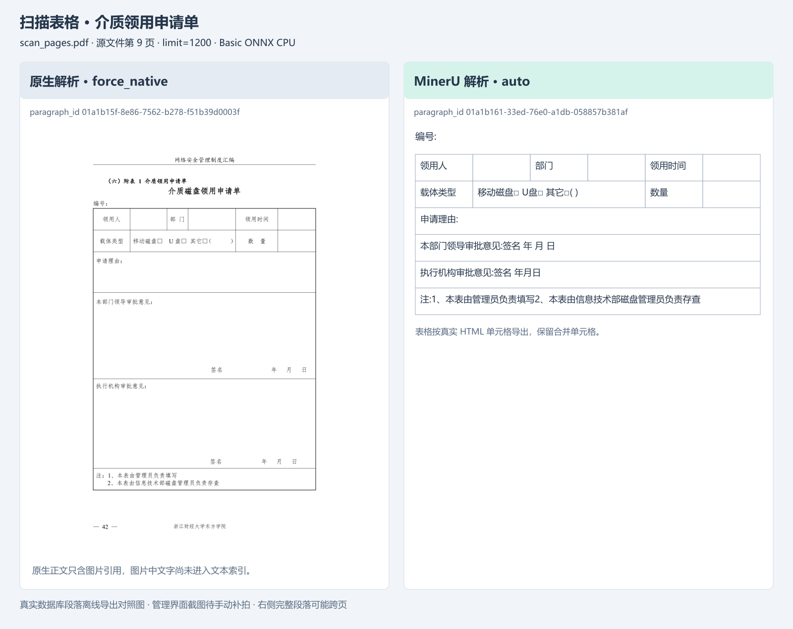

# Week 2 MinerU 接入实验报告

语料上传和原始检索实验于 2026-11-06 完成，失败核验与 v2 评测重跑于 2026-11-07 完成。原生回归的 Recall@1、Recall@5、MRR 在整体及逐题上与基线差值全部为 0。v2 中 Auto 的整体 Recall@5 从基线 56.67% 提升至 81.67%，MRR 从 0.4206 提升至 0.6608。扫描件命中从 0/10 提升至 9/10，图片从 0/10 提升至 9/10。

v2 修正了 q059 标准句中的多余“打”字，并处理已确认的 LaTeX 与斜杠表示差异。baseline、native、after 三份均使用相同新版题集和评分器实际重跑。相较 v1 的 Auto 76.67%，本次新增三题命中来自判定修正。三组各 60 题的 Top-5 段落 ID 和顺序与 v1 全部相同。完整变更及历史版本见 [评测 CHANGELOG](../eval/CHANGELOG.md)。

## 实验条件与回归

使用原基线的 11 份语料、60 道问题和用户确认的 `limit=1200、with_filter=true`。向量模型为 `shibing624/text2vec-base-chinese`，模型 ID 为 `42f63a3d-427e-11ef-b3ec-a8a1595801ab`。检索模式为 embedding，Top-5，相似度阈值 0.55，无 reranker。关键句按 normalization_version=2 处理 NFKC、大小写、空白、斜杠及支持的 LaTeX 表示后执行包含匹配，其他标点保留。

语料中的 scan_pages.pdf 是公开制度页生成的 10 页受控扫描件，未加入倾斜、模糊或拍照噪声。image_panels.pdf 是安全漫画的 10 页无文字层 PDF，图片类成绩对应这个容器中的文字题。它们各来自一个来源，当前结果用于本地固定语料比较。完整来源与页码映射见 [语料清单](../eval/assets/manifest.json)。

2026-11-06 的导入回归中，先关闭 MinerU 的 8000、8003、8004 服务，建立 Week2-native-1200，设置 `Knowledge.meta.mineru_route=force_native`。上传原语料后，69 个段落全部完成向量化，未新增 MinerU 解析任务，60 题均无接口错误。质量指标全部通过零差值检查后，再启动 MinerU 和 mineru 队列 worker，建立 Week2-auto-1200，设置 `auto`，上传同一批语料。

Auto 使用 MinerU 4.1.7 的 Basic ONNX CPU，8004 默认解析并发为 1。scan_pages.pdf 命中此前链路验收已发布的解析缓存，按本次 1200 参数重新分段；image_panels.pdf 新提交异步解析。缓存与本次解析均为相同引擎、协议和 tier。最终无 pending、failed 或 fallback 构建，全部 103 个段落完成向量化后才开始评测。缓存命中的扫描件质量结果来自既有解析输出，本轮没有重新测量其解析耗时。

九份继续走原生解析的文档共 49 段。native 与 Auto 的标题、正文和子块逐段比较，7 份完全一致，另 2 份仅有新建图片 File UUID 差异，排除资产 ID 后 9/9 一致。两份图像容器由原生各 10 个图片引用段落，变为扫描件 31 段、6108 字符，图片容器 23 段、3352 字符。核验记录见 [原生一致性与回退题审计](../eval/results/week2-audit.json)。

## 指标与题数

Recall 按问题宏平均。事实、表格、扫描件和图片题每题一条标准证据，命中数就是命中题数。跨段落型每题两条证据，括号列出命中证据数，并另列全部证据命中的题数。整体宏平均不能直接解释成整数命中题数。

| 类型 | 题数 | Recall@1，基线 → Auto | Recall@5，基线 → Auto | MRR，基线 → Auto |
| --- | ---: | --- | --- | --- |
| 事实型 | 20 | 60.00% → 55.00% | 85.00%（17/20 题）→ 80.00%（16/20 题） | 0.6783 → 0.6350 |
| **扫描件型** | 10 | 0.00% → 70.00% | 0.00%（0/10 题）→ 90.00%（9/10 题） | 0.0000 → 0.7833 |
| **图片型** | 10 | 0.00% → 80.00% | 0.00%（0/10 题）→ 90.00%（9/10 题） | 0.0000 → 0.8333 |
| **表格型** | 10 | 10.00% → 10.00% | 100.00%（10/10 题）→ 90.00%（9/10 题） | 0.4333 → 0.3950 |
| 跨段落型 | 10 | 30.00% → 30.00% | 70.00%（14/20 条证据）→ 60.00%（12/20 条证据） | 0.7333 → 0.6833 |

跨段落型收齐两条证据的问题为 5/10 → 4/10，至少命中一条证据为 9/10 → 8/10。60 题全部证据收齐比例为 32/60（53.33%）→ 47/60（78.33%）。每个 10 题的单证据类别中，一道题对应 10 个百分点。逐类型变化量与 MRR 完整表见 [compare.md](../eval/results/compare.md)，原生零差值表见 [native-compare.md](../eval/results/native-compare.md)。

| 运行 | 题数 / 错误数 | Recall@1 | Recall@5 | MRR | 平均检索耗时 |
| --- | ---: | ---: | ---: | ---: | ---: |
| 基线 | 60 / 0 | 26.67% | 56.67% | 0.4206 | 197.09 ms |
| force_native | 60 / 0 | 26.67% | 56.67% | 0.4206 | 189.84 ms |
| Auto | 60 / 0 | 50.00% | 81.67% | 0.6608 | 158.17 ms |

检索耗时包含顺序 HTTP 命中测试、问题向量化、检索和 JSON 解析，排除预热。每种配置仅运行一轮，耗时变化尚无重复实验支持其统计稳定性。DeepSeek 配置仍延后，端到端问答为 not_run，平均完整回答时间为 null。

## 表格回退与原六题复核

表格型 10/10 → 9/10 的唯一回退为 q039。目标文档是河南附件 1 Word，走原生解析，标准句“备案号”在段落和单个子块中均完整存在。目标在基线及 native 中排第 4，Auto 中排第 6，得分均为 0.599804。Auto 前五名依次来自 scan_pages.pdf、中卫制度、scan_pages.pdf、信阳预案、北方工业大学预案。新增扫描正文插入第 1、3 名，支持检索竞争导致 Top-5 挤占的判断。

| 题目 | v1 原因 | v2 状态 | 后续工作 |
| --- | --- | --- | --- |
| q039 | 新扫描段落竞争，原生表格从第 4 名降至第 6 名 | 失败，仍为第 6 名 | 表格及标题上下文试验，后续 rerank 对照。 |
| q048 | 正确段落第 1 名，摄氏温度以 LaTeX 表示 | 命中，第 1 名 | 纳入归一化回归样例。 |
| q049 | 关键句完整位于单个子块，表格 HTML 被切断，候选排第 21 | 失败，Top-5 未命中 | 第 3 周优先验证按行切分并附表头。 |
| q054 | 正确段落第 1 名，斜杠为 U+2215 | 命中，第 1 名 | 纳入符号规范化回归样例。 |
| q058 | 正确段落第 1 名，U 盘被 OCR 识别成 ∪盘 | 失败，保留 OCR 错误 | 局部复核或更高档位试验。 |
| q059 | 正确段落第 1 名，标准句多写“打”字 | 命中，第 1 名 | 已修正标注并记录版本。 |

q049 的标准句在完整候选检索中排第 21，得分 0.607255。其 HTML 被分成 3 个子块，标签在 `<td` 与 `colspan="6">` 之间断开。关键句本身仍在一个子块内，结构感知切分是否提升其排名应通过第 3 周实验验证。详细逐题记录与后续优先级见 [失败分析表](week2-failure-analysis.md)，原始证据见 [失败分析 JSON](../eval/results/week2-failure-analysis.json)。

## 上传性能与解析对照图

| 场景 | 已记录耗时 | 测量范围与来源 |
| --- | ---: | --- |
| 10 页扫描件同步热运行 | 约 57 秒，HTTP 57.399 秒 | 上传至完整 ZIP 下载，包含实际解析，见 benchmark.json。 |
| 异步预览未命中缓存 | 0.442 秒 | 返回 task_id 和占位段落，后续解析及构建继续执行。 |
| 预览命中解析缓存 | 0.176 秒 | 返回 31 个真实分段，无新解析任务。 |

以上为此前部署和上传链路验收的实测，来源分别为 [同步 benchmark](../services/mineru/results/benchmark.json) 与 [上传链路验收](../services/mineru/results/upload-e2e.json)。0.44 秒衡量上传预览响应，同步 57 秒包含解析计算，异步任务本身仍需完成解析与向量化。

以下三张图由本次 native、Auto 知识库中的真实段落和原始 File 图片资产离线导出。右侧为包含目标内容的段落，可能跨页。表格按实际 HTML 单元格渲染，图片资产以说明标记其所在位置，原始正文和图片引用完整保存在 [段落来源记录](../eval/results/week2-screenshot-sources.json)。图中包含双方段落 ID，可回查数据库。三张管理界面截图仍待手动补拍，当前导出图作为解析差异的可核验展示，界面截图按用户安排补拍后单独提交。






手动截图时，在文档列表分别打开 Week2-native-1200 与 Week2-auto-1200。对应 scan_pages.pdf 第 10 页备份正文、第 9 页介质表格，以及 image_panels.pdf 第 1 页安全建议。可按图中 paragraph_id 定位段落，左右并排后使用 Win + Shift + S 保存到 docs/images/，保留图中来源说明。

## 已知限制与下一轮优先级

- Basic 会将部分流程图及漫画对白区域保留为图片。当前题集主要覆盖可见文字，图形关系和空间推理尚未评测。
- PPT 第一版使用 Flash 文字提取，嵌入扫描图片的文字识别仍有限。
- ZIP 成员在 v1 一律走原生解析，工作流 document_extract_node 尚未接入 MinerU。
- pypdf 探测使用逐页软预算，单页卡死时无法中断。
- 前端全量 lint 有 72 条既有错误，已按用户确认记录阻塞。前一步的 type-check 与本次范围检查通过。
- 生产构建需要 4 GB Node.js 堆内存，已在 ui/README.md 写明 `NODE_OPTIONS=--max-old-space-size=4096`，供后续 Docker Compose 使用。
- 每类约 10 题、来源有限，当前扫描样本为清晰受控栅格化页面。v1 的 q059 标注与公式、斜杠表示偏差已在 v2 修正，q058 仍有已确认的 OCR 字符错误。

第 3 周按表格子块切分、子块标题路径、半天清洗流水线的顺序实施。按行切分并为每个子块附表头，再拼接“文档名 > 小节标题”，复用现有 Paragraph.chunks 父子结构，以 q049 和 q039 回到 Top-5 为验收目标。公式、符号规范化及 q059 标注修正已在本次 v2 完成。q058 可用于局部视觉复核试验，q039 保留为后续 rerank 的检索竞争样例。各项增益应通过固定版本的独立消融实验确认。

## 复现记录

```
python eval/run_eval.py --config eval/.local.json --output eval/results/baseline.json
python eval/run_eval.py --config eval/.local-native.json --output eval/results/native.json
python eval/compare.py eval/results/baseline.json eval/results/native.json --output eval/results/native-compare.md
python eval/run_eval.py --config eval/.local-auto.json --output eval/results/after.json
python eval/compare.py eval/results/baseline.json eval/results/after.json --output eval/results/compare.md
```

本机配置文件保存知识库和文档 ID，已忽略 Git。运行环境、模型、索引状态、每题命中和耗时保存在 [native.json](../eval/results/native.json) 与 [after.json](../eval/results/after.json)。运行前需确认异步构建与所有段落向量化完成。

| 校验项 | SHA-256 |
| --- | --- |
| dataset.jsonl | `b862fb7342227a55d9607077ad61c2c79a6ee0ff58045dc634797788ef0be419` |
| 语料 manifest | `ee41f93d70274f79b3a3a02458158dec5a1378a0345ffd946c5d5c9d7e3bf11f` |
| run_eval.py | `6f77e6013ff0cde1a4ee4c564635485506c615f9514c60c4f168b533631002d1` |
