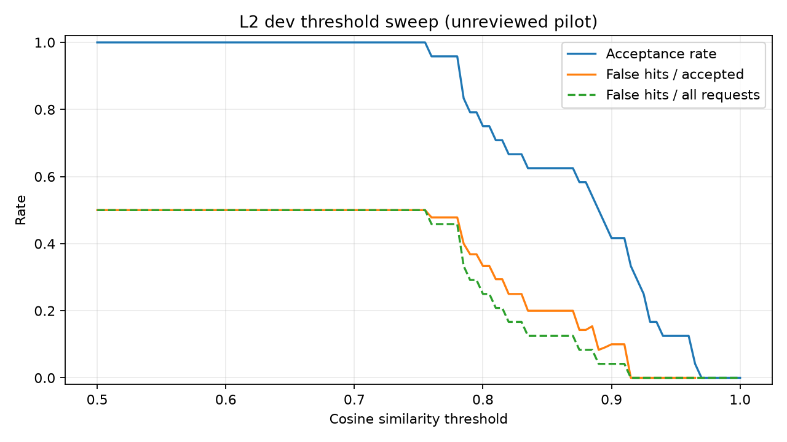

# L2 离线阈值实验

标注状态为 `assistant_draft_pending_human_review`。候选库冻结为 10 个原问题答案锚点。

开发集扫描阈值并选择接受率最高的合格点，测试集仅计算锁定阈值。误命中率为错误接受数除以接受数，零接受时记为空。

| 阈值 | 接受数 / 题数 | 接受率 | 错误接受数 | 误命中率 | 错误接受 / 全请求 |
| --- | ---: | ---: | ---: | ---: | ---: |
| 0.500 | 24/24 | 100.00% | 12 | 50.00% | 50.00% |
| 0.505 | 24/24 | 100.00% | 12 | 50.00% | 50.00% |
| 0.510 | 24/24 | 100.00% | 12 | 50.00% | 50.00% |
| 0.515 | 24/24 | 100.00% | 12 | 50.00% | 50.00% |
| 0.520 | 24/24 | 100.00% | 12 | 50.00% | 50.00% |
| 0.525 | 24/24 | 100.00% | 12 | 50.00% | 50.00% |
| 0.530 | 24/24 | 100.00% | 12 | 50.00% | 50.00% |
| 0.535 | 24/24 | 100.00% | 12 | 50.00% | 50.00% |
| 0.540 | 24/24 | 100.00% | 12 | 50.00% | 50.00% |
| 0.545 | 24/24 | 100.00% | 12 | 50.00% | 50.00% |
| 0.550 | 24/24 | 100.00% | 12 | 50.00% | 50.00% |
| 0.555 | 24/24 | 100.00% | 12 | 50.00% | 50.00% |
| 0.560 | 24/24 | 100.00% | 12 | 50.00% | 50.00% |
| 0.565 | 24/24 | 100.00% | 12 | 50.00% | 50.00% |
| 0.570 | 24/24 | 100.00% | 12 | 50.00% | 50.00% |
| 0.575 | 24/24 | 100.00% | 12 | 50.00% | 50.00% |
| 0.580 | 24/24 | 100.00% | 12 | 50.00% | 50.00% |
| 0.585 | 24/24 | 100.00% | 12 | 50.00% | 50.00% |
| 0.590 | 24/24 | 100.00% | 12 | 50.00% | 50.00% |
| 0.595 | 24/24 | 100.00% | 12 | 50.00% | 50.00% |
| 0.600 | 24/24 | 100.00% | 12 | 50.00% | 50.00% |
| 0.605 | 24/24 | 100.00% | 12 | 50.00% | 50.00% |
| 0.610 | 24/24 | 100.00% | 12 | 50.00% | 50.00% |
| 0.615 | 24/24 | 100.00% | 12 | 50.00% | 50.00% |
| 0.620 | 24/24 | 100.00% | 12 | 50.00% | 50.00% |
| 0.625 | 24/24 | 100.00% | 12 | 50.00% | 50.00% |
| 0.630 | 24/24 | 100.00% | 12 | 50.00% | 50.00% |
| 0.635 | 24/24 | 100.00% | 12 | 50.00% | 50.00% |
| 0.640 | 24/24 | 100.00% | 12 | 50.00% | 50.00% |
| 0.645 | 24/24 | 100.00% | 12 | 50.00% | 50.00% |
| 0.650 | 24/24 | 100.00% | 12 | 50.00% | 50.00% |
| 0.655 | 24/24 | 100.00% | 12 | 50.00% | 50.00% |
| 0.660 | 24/24 | 100.00% | 12 | 50.00% | 50.00% |
| 0.665 | 24/24 | 100.00% | 12 | 50.00% | 50.00% |
| 0.670 | 24/24 | 100.00% | 12 | 50.00% | 50.00% |
| 0.675 | 24/24 | 100.00% | 12 | 50.00% | 50.00% |
| 0.680 | 24/24 | 100.00% | 12 | 50.00% | 50.00% |
| 0.685 | 24/24 | 100.00% | 12 | 50.00% | 50.00% |
| 0.690 | 24/24 | 100.00% | 12 | 50.00% | 50.00% |
| 0.695 | 24/24 | 100.00% | 12 | 50.00% | 50.00% |
| 0.700 | 24/24 | 100.00% | 12 | 50.00% | 50.00% |
| 0.705 | 24/24 | 100.00% | 12 | 50.00% | 50.00% |
| 0.710 | 24/24 | 100.00% | 12 | 50.00% | 50.00% |
| 0.715 | 24/24 | 100.00% | 12 | 50.00% | 50.00% |
| 0.720 | 24/24 | 100.00% | 12 | 50.00% | 50.00% |
| 0.725 | 24/24 | 100.00% | 12 | 50.00% | 50.00% |
| 0.730 | 24/24 | 100.00% | 12 | 50.00% | 50.00% |
| 0.735 | 24/24 | 100.00% | 12 | 50.00% | 50.00% |
| 0.740 | 24/24 | 100.00% | 12 | 50.00% | 50.00% |
| 0.745 | 24/24 | 100.00% | 12 | 50.00% | 50.00% |
| 0.750 | 24/24 | 100.00% | 12 | 50.00% | 50.00% |
| 0.755 | 24/24 | 100.00% | 12 | 50.00% | 50.00% |
| 0.760 | 23/24 | 95.83% | 11 | 47.83% | 45.83% |
| 0.765 | 23/24 | 95.83% | 11 | 47.83% | 45.83% |
| 0.770 | 23/24 | 95.83% | 11 | 47.83% | 45.83% |
| 0.775 | 23/24 | 95.83% | 11 | 47.83% | 45.83% |
| 0.780 | 23/24 | 95.83% | 11 | 47.83% | 45.83% |
| 0.785 | 20/24 | 83.33% | 8 | 40.00% | 33.33% |
| 0.790 | 19/24 | 79.17% | 7 | 36.84% | 29.17% |
| 0.795 | 19/24 | 79.17% | 7 | 36.84% | 29.17% |
| 0.800 | 18/24 | 75.00% | 6 | 33.33% | 25.00% |
| 0.805 | 18/24 | 75.00% | 6 | 33.33% | 25.00% |
| 0.810 | 17/24 | 70.83% | 5 | 29.41% | 20.83% |
| 0.815 | 17/24 | 70.83% | 5 | 29.41% | 20.83% |
| 0.820 | 16/24 | 66.67% | 4 | 25.00% | 16.67% |
| 0.825 | 16/24 | 66.67% | 4 | 25.00% | 16.67% |
| 0.830 | 16/24 | 66.67% | 4 | 25.00% | 16.67% |
| 0.835 | 15/24 | 62.50% | 3 | 20.00% | 12.50% |
| 0.840 | 15/24 | 62.50% | 3 | 20.00% | 12.50% |
| 0.845 | 15/24 | 62.50% | 3 | 20.00% | 12.50% |
| 0.850 | 15/24 | 62.50% | 3 | 20.00% | 12.50% |
| 0.855 | 15/24 | 62.50% | 3 | 20.00% | 12.50% |
| 0.860 | 15/24 | 62.50% | 3 | 20.00% | 12.50% |
| 0.865 | 15/24 | 62.50% | 3 | 20.00% | 12.50% |
| 0.870 | 15/24 | 62.50% | 3 | 20.00% | 12.50% |
| 0.875 | 14/24 | 58.33% | 2 | 14.29% | 8.33% |
| 0.880 | 14/24 | 58.33% | 2 | 14.29% | 8.33% |
| 0.885 | 13/24 | 54.17% | 2 | 15.38% | 8.33% |
| 0.890 | 12/24 | 50.00% | 1 | 8.33% | 4.17% |
| 0.895 | 11/24 | 45.83% | 1 | 9.09% | 4.17% |
| 0.900 | 10/24 | 41.67% | 1 | 10.00% | 4.17% |
| 0.905 | 10/24 | 41.67% | 1 | 10.00% | 4.17% |
| 0.910 | 10/24 | 41.67% | 1 | 10.00% | 4.17% |
| 0.915 | 8/24 | 33.33% | 0 | 0.00% | 0.00% |
| 0.920 | 7/24 | 29.17% | 0 | 0.00% | 0.00% |
| 0.925 | 6/24 | 25.00% | 0 | 0.00% | 0.00% |
| 0.930 | 4/24 | 16.67% | 0 | 0.00% | 0.00% |
| 0.935 | 4/24 | 16.67% | 0 | 0.00% | 0.00% |
| 0.940 | 3/24 | 12.50% | 0 | 0.00% | 0.00% |
| 0.945 | 3/24 | 12.50% | 0 | 0.00% | 0.00% |
| 0.950 | 3/24 | 12.50% | 0 | 0.00% | 0.00% |
| 0.955 | 3/24 | 12.50% | 0 | 0.00% | 0.00% |
| 0.960 | 3/24 | 12.50% | 0 | 0.00% | 0.00% |
| 0.965 | 1/24 | 4.17% | 0 | 0.00% | 0.00% |
| 0.970 | 0/24 | 0.00% | 0 | — | 0.00% |
| 0.975 | 0/24 | 0.00% | 0 | — | 0.00% |
| 0.980 | 0/24 | 0.00% | 0 | — | 0.00% |
| 0.985 | 0/24 | 0.00% | 0 | — | 0.00% |
| 0.990 | 0/24 | 0.00% | 0 | — | 0.00% |
| 0.995 | 0/24 | 0.00% | 0 | — | 0.00% |
| 1.000 | 0/24 | 0.00% | 0 | — | 0.00% |

## 锁定阈值

```json
{
  "dev": {
    "threshold": 0.915,
    "query_count": 24,
    "accepted": 8,
    "wrong_accepted": 0,
    "acceptance_rate": 0.3333333333333333,
    "false_hit_rate": 0.0,
    "wrong_per_request": 0.0,
    "correct_acceptance_rate": 0.3333333333333333
  },
  "test": {
    "threshold": 0.915,
    "query_count": 16,
    "accepted": 7,
    "wrong_accepted": 1,
    "acceptance_rate": 0.4375,
    "false_hit_rate": 0.14285714285714285,
    "wrong_per_request": 0.0625,
    "correct_acceptance_rate": 0.375
  }
}
```

样本数有限。助手草案的标签需经人工确认，阈值结果用于离线探索。


